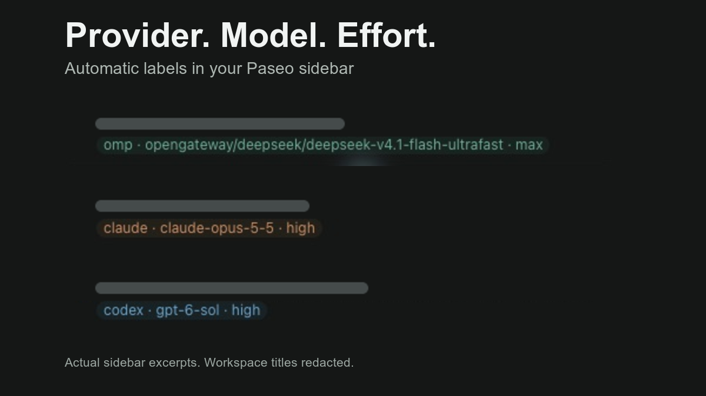

# Paseo auto labels

See each workspace's provider, model, and effort in Paseo's sidebar. Auto labels adds and updates the labels for you.



Real sidebar excerpts, with workspace titles redacted. Each label follows `provider · model · effort`.

The plugin syncs existing workspaces when it starts and watches session settings for changes. Changing a model or effort replaces the label it added. Workspace and session titles stay available to tools such as session-triage.

## Install

Requires Paseo 0.11.4 or later and npm on the daemon machine.

```sh
paseo plugin install github:sm1ee/paseo-auto-label
```

Settings are under **Settings → Plugins → Auto labels**. The Command Center also has **Auto labels settings**. If labels are assigned but hidden in the sidebar, enable **Labels** in Paseo's sidebar display options.

## What gets labelled

- Each visible, nonarchived workspace gets one label per distinct main-session configuration.
- Multiple sessions with the same configuration share a label.
- Subagents are excluded by default. **Include subagents** adds their configurations too.
- Background workspaces and private helper sessions are excluded.
- Other labels keep their assignments. A matching label that was already assigned manually is preserved too.

The provider is Paseo's harness ID, such as `codex`, `claude`, `omp`, or `opencode`. Model IDs keep their full provider prefixes. Effort uses the selected thinking option, then the effective option, then reported runtime metadata. A missing value appears as `model unknown` or `effort unknown`.

These are Paseo's selected or reported values. They do not prove which model an external gateway ultimately used.

## Controls

**Auto labels** pauses or resumes automatic updates. Pausing keeps existing labels.

**Sync now** checks the host's existing workspaces again, including later pages of results.

**Remove generated labels** pauses syncing and removes only assignments recorded as added by this plugin from active workspaces. Label definitions remain in Paseo's label manager for reuse. You can delete unused definitions there.

**Paseo home** is normally detected from `PASEO_HOME` or `~/.paseo`. Set it only if the daemon uses a different home. The plugin checks the daemon's process and server identity before connecting. It supports loopback TCP listeners and local sockets. Use one installation per daemon.

## Data and compatibility

The daemon-side worker reads session configuration metadata and workspace labels. It does not fetch conversation history, send prompts, change model settings, or call model providers. It uses the daemon's existing local credential in memory; the credential is not copied into plugin settings or its data file.

An ownership journal is stored at `<PASEO_HOME>/plugin-data/paseo-auto-label/ownership.json` with private file permissions. It contains the host ID, workspace IDs, and generated label names. Keep it if you want the plugin to recognize its previous assignments after reinstalling. Removing the plugin stops syncing; use **Remove generated labels** first if you want to remove its assignments.

Paseo's public plugin API does not expose workspace label mutations in 0.11.4. The daemon adapter uses the exported low-level client from `@getpaseo/client`, pinned to 0.11.4. It checks the host's workspace-label capability and keeps that adapter out of client code. Future protocol changes may require an update.

## Development

```sh
npm ci --ignore-scripts
npm run typecheck
npm test
paseo plugin install /absolute/path/to/paseo-auto-label
```

After editing an installed directory source:

```sh
paseo plugin reload paseo-auto-label
```

Tests cover configuration precedence, multiple sessions, pagination, ownership, setting changes during a write, recovery after a lost response, and cleanup. They use local test fixtures and do not start model sessions.
